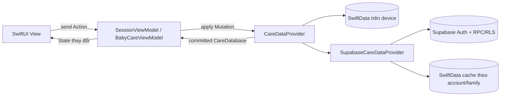

# Kiến trúc BabyCare

Ứng dụng dùng MVVM với Observation (`@Observable`) và luồng dữ liệu một chiều:

## Ranh giới các layer

- `Domain/`: các value model `Codable`, `Sendable`, không import SwiftData hoặc SwiftUI; `CareDataMutation` là tập thao tác ghi có kiểm tra dữ liệu.
- `Data/CareDataProvider.swift`: contract bất đồng bộ duy nhất mà ViewModel sử dụng. Một mutation phải thành công toàn bộ hoặc throw mà không công bố dữ liệu dở dang.
- `Data/SwiftData/`: implementation độc lập trên thiết bị. `ModelContext` và các class `@Model` được giữ kín trong actor; bên ngoài chỉ nhận `CareDatabase` dạng value.
- `Data/Cloud/`: DTO/wire contract v1, Supabase remote, mutation journal và SwiftData cache tách theo project/user/family. Cache chỉ phục vụ đọc offline; mọi thao tác ghi cloud phải được RPC xác nhận.
- `ViewModels/`: `@Observable`, sở hữu State và nhận Action. State chỉ đổi sau khi provider trả về snapshot đã commit.
- `Views/`: đọc State và gửi Action. State cục bộ như sheet, bộ lọc và text field draft vẫn thuộc View hoặc form ViewModel.
- `Services/`: side effect ngoài database. Notification được đối chiếu sau khi database commit thành công.
- `AppDependencies.swift`: composition root chọn provider thật, provider test hoặc dữ liệu preview.

## Lưu dữ liệu trên device

`SwiftDataCareDataProvider` mở file `Application Support/BabyCare/BabyCare.store`. Hồ sơ, hoạt động, số đo, đợt theo dõi, timer ngủ và lịch nhắc đều nằm trong SwiftData nên vẫn còn sau khi kill app và mở lại. Ảnh đại diện và ảnh đính kèm dùng external storage của SwiftData.

Phiên bản cũ lưu `Application Support/BabyCare/care-data.json`. Lần chạy đầu sau nâng cấp sẽ nhập file này vào SwiftData trong cùng transaction với migration marker. File JSON cũ được giữ nguyên làm bản phục hồi; dữ liệu lỗi không bị ghi đè.

## Cloud provider đã tích hợp

`SessionViewModel` khôi phục Supabase session từ Keychain, tách vòng đời provider theo account và family, hủy provider cũ khi đổi tài khoản. App dùng email/mật khẩu, xác nhận email và callback `babycare://auth-callback`.

`SupabaseCareDataProvider` chuyển mutation thành DTO rõ ràng rồi gọi RPC batch. Trước khi gọi mạng, provider lưu `operation_id`, envelope và state dự kiến vào cache; timeout sẽ retry đúng request để backend trả receipt cũ. Server reject version cũ. State UI chỉ cập nhật sau receipt. Nếu server đã commit nhưng cache local lỗi, UI vẫn nhận state đã lưu và hiển thị cảnh báo cache.

Cache nằm tại:

`Application Support/BabyCare/Cloud/cxlqvuqloaokzmaewvdy/<user UUID>/<family UUID>/Cache.store`

Khi RLS thu hồi quyền family, provider xóa cache của family đó trước khi báo lỗi. Đăng xuất vô hiệu hóa token lease, hủy network session và xóa dữ liệu đang hiển thị. Lịch thông báo được tạo lại từ snapshot của account/family hiện tại và gỡ khi rời phiên.

Ảnh cloud và import dữ liệu SwiftData cũ chưa thuộc giai đoạn này. Provider từ chối mutation có ảnh để tránh báo lưu thành công trong khi byte ảnh chưa được upload. Dữ liệu trên máy không tự được gửi lên khi đăng nhập.

## Tài khoản và tối đa 4 bé (12/09/2026)

App không còn màn chọn/tạo family hay thao tác chọn family trong Cài đặt. Sau đăng nhập, SessionViewModel tự mở vùng dữ liệu trước đó; tài khoản mới tự tạo vùng dữ liệu rồi vào bước tạo bé. Lỗi tải tài khoản hiển thị Thử lại/Đăng xuất.

Các bảng/khóa family giữ làm namespace nội bộ để tương thích RLS, Storage và outbox; không xóa dữ liệu hoặc thay ID. Supabase đã được áp dụng migration `202609110005_account_babies.sql`: tạo namespace tài khoản theo cách idempotent và trigger giới hạn 4 bé sống trên tổng namespace do tài khoản sở hữu. Dữ liệu legacy vượt giới hạn không bị xóa; không cho thêm bé mới.

CareDatabase kiểm tra giới hạn 4 bé cho các provider, kể cả offline. Retry cùng ID không tính thành bé mới. Hồ sơ bé hiển thị số lượng /4 và vô hiệu hóa thêm khi đủ; menu Chọn bé và danh sách hồ sơ vẫn chuyển bé bằng selectBaby.

Kiểm chứng: 19/19 test iOS đạt (BabyLimitTests, CloudProviderTests, BabyCareUITests). SQL thử nghiệm trên Supabase xác nhận tạo namespace lặp lại trả cùng ID và bé thứ 5 bị từ chối; toàn bộ bản ghi thử nghiệm rollback. Preflight không có tài khoản nhiều namespace, thành viên chia sẻ hoặc hồ sơ bé cần chuyển đổi. Chưa kiểm thử đăng nhập Google thật trong đợt thay đổi này.

## App language

- `AppLanguage` selects the device's primary language on first launch: Vietnamese for `vi`, English for `en` and all unsupported languages. The choice is persisted in `care.language`; later device language changes do not overwrite an explicit app preference.
- The same language picker appears on Sign In and Settings. It updates the root locale without recreating the session, navigation stack or form drafts.
- `L10n` loads explicit `en.lproj` / `vi.lproj` bundles. Reviewed translations live in `Tools/Localization/translations.json`; run `python3 Tools/Localization/generate.py` from this project to regenerate `Localizable.strings`. Numbered placeholders are substituted once so user input is never interpreted as a format string.
- Counted phrases go through `L10n.count(_:one:many:)` with a separate singular key (`"1 cữ"` → "1 feed", `"{0} cữ"` → "{0} feeds"); Vietnamese keys differ only by the number. Baby age text comes from `BabyProfile.ageText` so the header and profile forms agree.
- Transient confirmations (`BabyCareViewModel.toast`) show as a top banner for 4 seconds via `careToastBanner()`, attached to `ContentView` and to the sheets that stay open after a save (activity picker, text size); it never blocks taps and `ContentView` announces it once to VoiceOver.
- Persisted activity kinds, option values, units, picker tags and speech parser vocabulary remain stable. Translation happens only when displaying those values; free-form names, notes and medicine names are not translated.
- Date/number presentation follows the selected app locale. iOS permission dialogs use the OS-selected app language through `InfoPlist.strings`.
- Voice recognition and parsing still support Vietnamese. English UI explicitly labels Vietnamese voice examples. Switching UI language does not change the parser or infer new voice commands.
