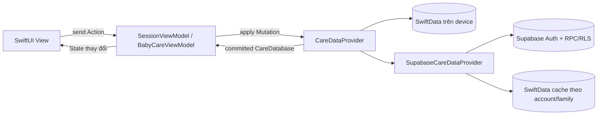

# Kiến trúc BabyCare

Ứng dụng dùng MVVM với Observation (`@Observable`) và luồng dữ liệu một chiều:

## Ranh giới các layer

- `Domain/`: các value model `Codable`, `Sendable`, không import SwiftData hoặc SwiftUI; `CareDataMutation` là tập thao tác ghi có kiểm tra dữ liệu.
- `Data/CareDataProvider.swift`: contract bất đồng bộ duy nhất mà ViewModel sử dụng. Một mutation phải thành công toàn bộ hoặc throw mà không công bố dữ liệu dở dang.
- `Data/SwiftData/`: implementation độc lập trên thiết bị. `ModelContext` và các class `@Model` được giữ kín trong actor; bên ngoài chỉ nhận `CareDatabase` dạng value.
- `Data/Cloud/`: DTO/wire contract v1, Supabase remote, mutation journal và SwiftData cache tách theo project/user/family. Cache chỉ phục vụ đọc offline; mọi thao tác ghi cloud phải được RPC xác nhận.
- `ViewModels/`: `@Observable`, sở hữu State và nhận Action. State chỉ đổi sau khi provider trả về snapshot đã commit.
- `Views/`: đọc State và gửi Action. State cục bộ như sheet, bộ lọc và text field draft vẫn thuộc View hoặc form ViewModel.
- `Services/`: side effect ngoài database. Notification được đối chiếu sau khi database commit thành công.
- `AppDependencies.swift`: composition root chọn provider thật, provider test hoặc dữ liệu preview.

## Lưu dữ liệu trên device

`SwiftDataCareDataProvider` mở file `Application Support/BabyCare/BabyCare.store`. Hồ sơ, hoạt động, số đo, đợt theo dõi, timer ngủ và lịch nhắc đều nằm trong SwiftData nên vẫn còn sau khi kill app và mở lại. Ảnh đại diện và ảnh đính kèm dùng external storage của SwiftData.

Phiên bản cũ lưu `Application Support/BabyCare/care-data.json`. Lần chạy đầu sau nâng cấp sẽ nhập file này vào SwiftData trong cùng transaction với migration marker. File JSON cũ được giữ nguyên làm bản phục hồi; dữ liệu lỗi không bị ghi đè.

## Cloud provider đã tích hợp

`SessionViewModel` khôi phục Supabase session từ Keychain, tách vòng đời provider theo account và family, hủy provider cũ khi đổi tài khoản. App dùng email/mật khẩu, xác nhận email và callback `babycare://auth-callback`.

`SupabaseCareDataProvider` chuyển mutation thành DTO rõ ràng rồi gọi RPC batch. Trước khi gọi mạng, provider lưu `operation_id`, envelope và state dự kiến vào cache; timeout sẽ retry đúng request để backend trả receipt cũ. Server reject version cũ. State UI chỉ cập nhật sau receipt. Nếu server đã commit nhưng cache local lỗi, UI vẫn nhận state đã lưu và hiển thị cảnh báo cache.

Cache nằm tại:

`Application Support/BabyCare/Cloud/cxlqvuqloaokzmaewvdy/<user UUID>/<family UUID>/Cache.store`

Khi RLS thu hồi quyền family, provider xóa cache của family đó trước khi báo lỗi. Đăng xuất vô hiệu hóa token lease, hủy network session và xóa dữ liệu đang hiển thị. Lịch thông báo được tạo lại từ snapshot của account/family hiện tại và gỡ khi rời phiên.

Ảnh cloud đã có ở giai đoạn sau (`CloudMedia`, `SupabaseRemote.syncMedia`): byte ảnh nằm trong outbox cho tới khi cả bản ghi và file được xác nhận. Import dữ liệu SwiftData cũ chưa thuộc giai đoạn này; dữ liệu trên máy không tự được gửi lên khi đăng nhập.

## Trường có cấu trúc trong hoạt động (24/10/2026)

Các trường mới được lưu bằng chữ tiếng Việt trong các cột sẵn có (`value`, `unit`, `detail`, `babies.allergies`), nên contract cloud và SwiftData không đổi và bản 1.0.x vẫn đọc được dưới dạng chữ thường. Parser nằm trong `Domain/CareEntryDetails.swift`, đọc lỏng: chữ không đúng dạng được giữ nguyên.

| Dữ liệu | Cột | Ví dụ |
| --- | --- | --- |
| Triệu chứng + mức con | `value` | `Sốt (1–2 ngày), Ho (khan)` (`SymptomCatalog`) |
| Dị ứng: tên · mức độ · độ chắc chắn | `value`; hồ sơ bé: mỗi dòng một dị ứng trong `allergies` | `Trứng gà · Nhẹ · Nghi ngờ` (`AllergyNote`) |
| Vị trí đo · loại nhiệt kế | `detail` | `Hậu môn · Điện tử` (`TemperatureDetail`) |
| Bữa ăn: thực phẩm / số lượng (đều tùy chọn) | `value` / `unit` | `Cháo bí đỏ` / `1/2 bát` (`MealEntry`) |
| Thuốc không tên nhưng có ảnh (chụp bằng camera hoặc chọn từ album) | `detail` rỗng + ảnh đính kèm | `CareValidation.activity` |
| Đi khám: lý do / chẩn đoán / lời dặn | `value` / `unit` / `detail` | `DoctorVisit` |

Nhịp thở là `ActivityKind.breathing` (đơn vị `lần/phút`, `detail` = lúc đếm), cần migration `202610240011_health_details.sql`. Bản 1.0.x coi kind lạ là dữ liệu hỏng và không tải được cả family, nên `babycare_read_page` chỉ trả kind mới khi client gửi `p_api_version >= 2`; app từ 1.1 gửi 2, gặp server chưa có migration (PGRST202) thì gọi lại kiểu cũ, và bỏ qua kind lạ thay vì báo lỗi. Ngưỡng tham khảo: nhiệt độ theo vị trí (`TemperatureReference`, khoảng thường dùng tại bệnh viện Việt Nam) và mốc thở nhanh của WHO IMCI theo tháng tuổi (`BreathingReference`).

Hai trường cần cột mới (cùng migration 0011): `BabyProfile.medicalHistory` (`babies.medical_history`) và `CareActivity.followUpDate` của lần đi khám (`care_activities.follow_up_at`, `detail` là lời dặn của bác sĩ). `babycare_apply` gộp field gửi lên vào bản ghi cũ nên bản 1.0.x sửa bản ghi không xoá hai cột này. App chỉ gửi hai cột khi có giá trị và gửi giá trị rỗng khi người dùng xoá (`CloudMapping.optionalColumns`). Outbox bỏ một thay đổi bị server từ chối vì dữ liệu (SQLSTATE 22/23, `CloudError.rejected`), phát lại các thay đổi sau trên bản đã lưu và báo một lần, thay vì để nó chặn mọi lần lưu và tải. Trên máy, SwiftData V3 thêm hai bảng phụ `BabyDetailsEntity`/`ActivityFollowUpEntity` theo id bản ghi (giống `VaccinationEntity`), để entity V1/V2 giữ nguyên. Lịch khám lại được nhắc trước 2 ngày (`DoctorFollowUp`, `LocalCareReminderService`) và hiện trên màn Ghi nhanh khi còn trong 14 ngày. Giờ ngủ khuyến cáo theo tuổi: `SleepRecommendation` (WHO 2019 dưới 5 tuổi, AASM từ 6 tuổi).

## Tài khoản và tối đa 4 bé (12/09/2026)

App không còn màn chọn/tạo family hay thao tác chọn family trong Cài đặt. Sau đăng nhập, SessionViewModel tự mở vùng dữ liệu trước đó; tài khoản mới tự tạo vùng dữ liệu rồi vào bước tạo bé. Lỗi tải tài khoản hiển thị Thử lại/Đăng xuất.

Các bảng/khóa family giữ làm namespace nội bộ để tương thích RLS, Storage và outbox; không xóa dữ liệu hoặc thay ID. Supabase đã được áp dụng migration `202609110005_account_babies.sql`: tạo namespace tài khoản theo cách idempotent và trigger giới hạn 4 bé sống trên tổng namespace do tài khoản sở hữu. Dữ liệu legacy vượt giới hạn không bị xóa; không cho thêm bé mới.

CareDatabase kiểm tra giới hạn 4 bé cho các provider, kể cả offline. Retry cùng ID không tính thành bé mới. Hồ sơ bé hiển thị số lượng /4 và vô hiệu hóa thêm khi đủ; menu Chọn bé và danh sách hồ sơ vẫn chuyển bé bằng selectBaby.

Kiểm chứng: 19/19 test iOS đạt (BabyLimitTests, CloudProviderTests, BabyCareUITests). SQL thử nghiệm trên Supabase xác nhận tạo namespace lặp lại trả cùng ID và bé thứ 5 bị từ chối; toàn bộ bản ghi thử nghiệm rollback. Preflight không có tài khoản nhiều namespace, thành viên chia sẻ hoặc hồ sơ bé cần chuyển đổi. Chưa kiểm thử đăng nhập Google thật trong đợt thay đổi này.

## App language

- `AppLanguage` selects the device's primary language on first launch: Vietnamese for `vi`, English for `en` and all unsupported languages. The choice is persisted in `care.language`; later device language changes do not overwrite an explicit app preference.
- The same language picker appears on Sign In and Settings. It updates the root locale without recreating the session, navigation stack or form drafts.
- `L10n` loads explicit `en.lproj` / `vi.lproj` bundles. Reviewed translations live in `Tools/Localization/translations.json`; run `python3 Tools/Localization/generate.py` from this project to regenerate `Localizable.strings`. Numbered placeholders are substituted once so user input is never interpreted as a format string.
- Counted phrases go through `L10n.count(_:one:many:)` with a separate singular key (`"1 cữ"` → "1 feed", `"{0} cữ"` → "{0} feeds"); Vietnamese keys differ only by the number. Baby age text comes from `BabyProfile.ageText` so the header and profile forms agree.
- Transient confirmations (`BabyCareViewModel.toast`) show as a top banner for 4 seconds via `careToastBanner()`, attached to `ContentView` and to the sheets that stay open after a save (activity picker, text size); it never blocks taps and `ContentView` announces it once to VoiceOver.
- Persisted activity kinds, option values, units, picker tags and speech parser vocabulary remain stable. Translation happens only when displaying those values; free-form names, notes and medicine names are not translated.
- Date/number presentation follows the selected app locale. iOS permission dialogs use the OS-selected app language through `InfoPlist.strings`.
- Voice recognition and parsing still support Vietnamese. English UI explicitly labels Vietnamese voice examples. Switching UI language does not change the parser or infer new voice commands.

## iPhone Duo (cập nhật 23/10/2026, Xcode 27.1)

Số liệu đo trên simulator iOS 27.1 (Device Hub):

| Trạng thái | Cửa sổ | Size class | Vùng dành riêng (pt, toạ độ cửa sổ) |
| --- | --- | --- | --- |
| Gập (màn ngoài) | 466 × 678 | compact/regular | occlusion: camera 37 × 37 tại (399.7, 29.3), cụm trạng thái 84 × 174 góc trên phải |
| Mở nằm ngang (màn trong) | 951 × 669 | regular/regular | division (bản lề) x 455.5–495.5 cao toàn màn; occlusion 84 × 124 góc trên phải |
| Mở dọc (màn trong) | 669 × 951 | regular/regular | chưa đo (cần xoay trong Device Hub) |

Hệ thống chừa nguyên dải 84 pt bên phải làm safe area ở cả hai màn. Simulator khởi động lại luôn ở trạng thái gập; chỉ Device Hub gập/mở được (không có lệnh `simctl` hay API XCUITest), và `xcodebuild test` chạy song song sẽ dùng bản clone ở trạng thái gập.

Thiết kế (`DesignSystem/CareAdaptiveLayout.swift`):

- `careAdaptiveRoot()` gắn ở `AppRootView`: một UIView thăm dò đọc `UIView.reservedRegions(kind: .division/.occlusion)` (iOS 27.1, chỉ có ở UIKit) và `UIHingeInteraction`, đưa `CareWindowMetrics` (kích thước cửa sổ, nếp gấp, vùng che, size class) vào environment. iOS dưới 27.1 và thiết bị không gập chỉ có kích thước.
- `CareColumns { trái } trailing: { phải }` + `CareColumnsLayout`: một cột ≤ 620 pt (iPhone, Duo gập, Duo mở dọc 669 pt, chữ cỡ trợ năng) hoặc hai cột khi cửa sổ regular width ≥ 760 pt; khe giữa nới rộng để phủ trọn nếp gấp cộng 12 pt mỗi bên. Hai cột giữ identity khi chuyển nên gập/mở không mất state. Phép tính thuần nằm trong `CareColumnsPlan` (có unit test).
- `careTabs(_:)`: tab bar dưới như cũ, chuyển thành thanh dọc 84 pt bên trái khi cửa sổ regular width ≥ 860 pt (Duo mở ngang, iPad ngang) để tab giữa không nằm trên bản lề và nội dung giữ chiều cao.
- Màn hai cột: Ghi nhanh (trạng thái | danh mục, gần đây), Theo dõi ốm (đợt ốm, nhắc thuốc | nhật ký đợt), Thống kê (biểu đồ chính | tổng quan; Tăng trưởng: biểu đồ | lịch sử số đo), Hồ sơ bé, Chia sẻ báo cáo.
- Nhật ký: danh sách | chi tiết, chia đúng giữa nếp gấp; chọn thẻ mở chi tiết ở khung phải (`ActivityDetailContent` dùng chung với màn chi tiết). Gập máy khi đang xem chi tiết thì chi tiết được đẩy toàn màn; mở máy khi đang ở màn chi tiết thì quay về danh sách với chi tiết ở khung phải.
- Nền tab bar và đường kẻ header chạy dưới dải safe area bên phải; nội dung vẫn tránh vùng che. Thanh điều hướng hệ thống tự xếp quanh vùng che (nút Back nằm dưới cụm trạng thái khi mở ngang).
- Sheet do hệ thống đặt giữa màn, tức trùng tâm bản lề khi mở Duo; lưới ô của bảng chọn hoạt động nới khe giữa để phủ bản lề. Form và cài đặt (`List`/`Form`) giữ một cột.
- Đã kiểm trên simulator (23/10/2026): app đang chạy tự đổi bố cục khi gập/mở; gập khi đang xem chi tiết Nhật ký thì chi tiết hiện toàn màn ngoài, mở lại thì về danh sách với chi tiết ở khung phải.

Kiểm thử: `AdaptiveLayoutTests` (unit) cho phép chia cột với số đo thật của Duo; `AdaptiveLayoutUITests.testTabsPickerAndFormInPortraitAndLandscape` chạy mọi destination; `testWideWindowUsesRailColumnsAndDiaryDetailPane` chạy khi cửa sổ ≥ 860 × 600 pt (Duo mở, iPad ngang), tự bỏ qua trên iPhone, và kiểm tra thêm phần tử không vắt qua bản lề khi cửa sổ hẹp hơn 1000 pt. Muốn chạy trên Duo mở: mở máy trong Device Hub rồi chạy với `-parallel-testing-enabled NO` để không tạo clone. Trên màn trong, `app.frame` của XCUITest vẫn báo 669 × 951 và lệnh xoay không có tác dụng, nên test dùng `app.windowFrame` (khung cửa sổ). Test nào xoay máy phải trả về portrait trong `defer`, nếu không các test sau trên cùng simulator chạy ở hướng ngang và hỏng.
